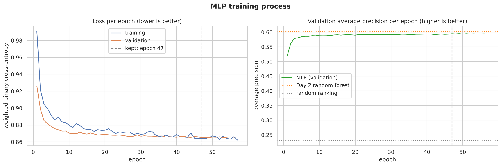
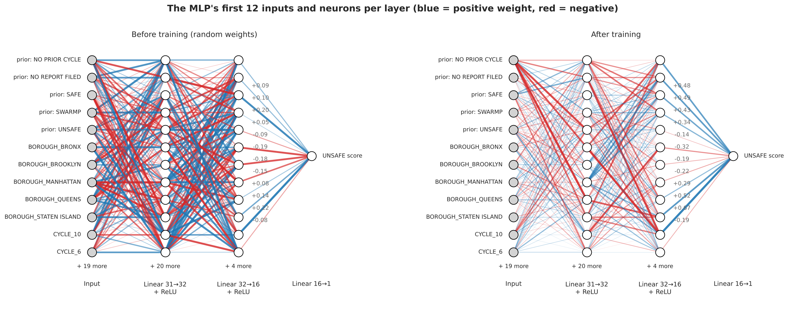
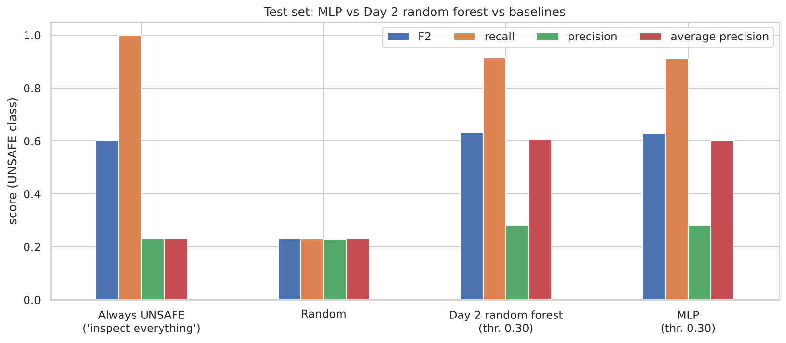
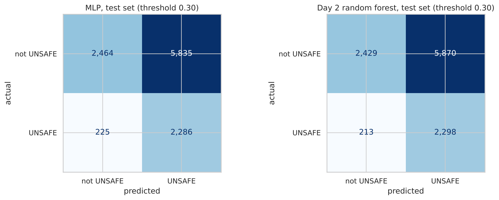
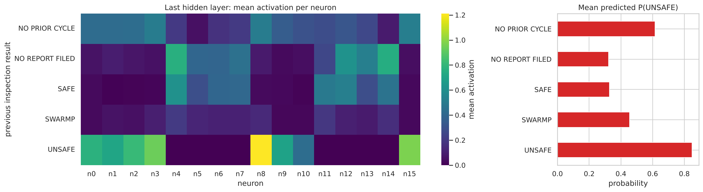
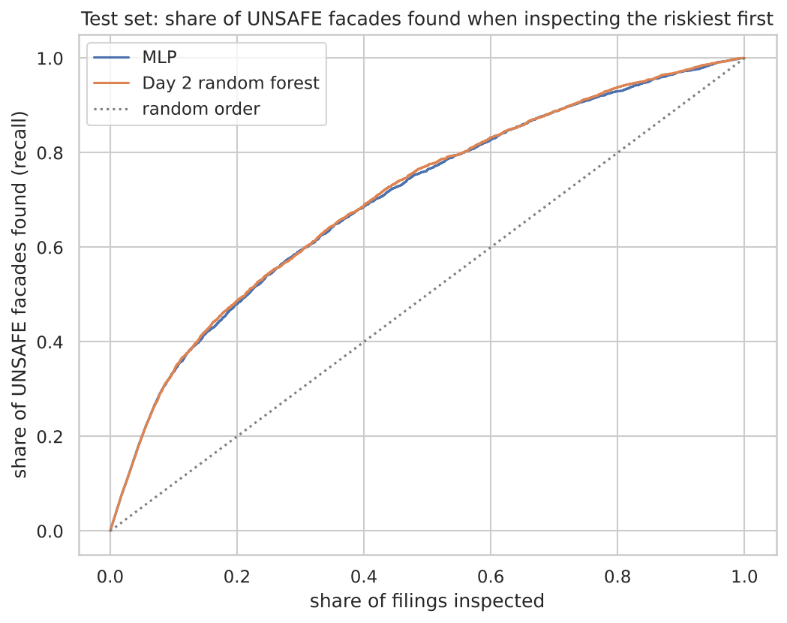
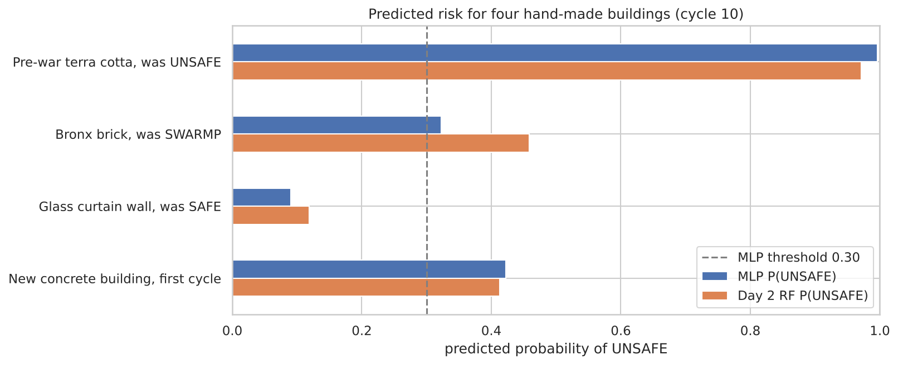

# NYC building facades: a neural network for unsafe facade inspections

**Team:** Amelia, Jerome, Kazuko, Sahil
**Course:** AI Methods I – Day 4: Neural networks (IAAC MaAI 2026/27)
**Track:** A1 – MLP on tables

> **Model on Hugging Face:** https://huggingface.co/iaac-maai/day4-team1-unsafe-facade-mlp
> <!-- TODO: check the repository name before uploading -->

## Use case

Every New York City building taller than 6 stories must have its facade inspected every 5 years (FISP, Local Law 11). An **UNSAFE**
facade can drop bricks, stone or terra cotta onto the sidewalk. The model is for the **NYC Department of Buildings or a facade consultant**,
at the start of a new cycle and **before any inspection**, to **rank buildings by risk** and decide which facades to inspect first.

**Missing an UNSAFE facade is the expensive mistake** (someone can be hurt); a false alarm only costs an earlier inspection. So we
favour recall and use **F2**. On Day 2 a random forest solved this task; today we check whether a neural network does better on
exactly the same data, features and test set.

## Dataset

| | |
|---|---|
| **Name** | DOB NOW: Safety – Facades Compliance Filings |
| **Source** | [NYC Open Data, xubg-57si](https://data.cityofnewyork.us/d/xubg-57si) |
| **Version used** | `facades_clean.csv`, cleaned in our [Day 2 assignment](https://github.com/iaac-maai/group1_day2_assignment), downloaded by the notebook from our [Day 3 repository](https://github.com/iaac-maai/group1_day3_assignment) |
| **One row is** | one initial facade inspection report of one building in one 5-year cycle |
| **Size** | 54,049 initial filings of 15,767 buildings, 23.2% UNSAFE |
| **Licence** | NYC Open Data, free public use under the [NYC Terms of Use](https://www.nyc.gov/home/terms-of-use.page) |

The data is not committed: the notebook downloads it into `data/`.

## Repository structure

```
├── data/                 # only .gitkeep; the notebook downloads facades_clean.csv here (not committed)
├── figures/              # the 9 figures exported by the notebook (committed, shown below)
├── models/
│   ├── README.md         # the Hugging Face model card
│   ├── *.png             # figures shown in the model card
│   ├── config.json       # architecture settings, feature order, threshold
│   ├── model.pt          # network weights (not committed: on Hugging Face)
│   └── scaler.joblib     # fitted preprocessing (not committed: on Hugging Face)
├── notebook/
│   └── neural_network.ipynb   # the whole work: data, baseline, training, diagnosis, tuning, test, application, saving
├── .gitignore
├── LICENSE               # MIT
├── README.md
└── requirements.txt      # pinned package versions
```

## How to run

```bash
python -m venv .venv
.venv\Scripts\activate           # macOS/Linux: source .venv/bin/activate
pip install -r requirements.txt
```

Select the `.venv` kernel, open `notebook/neural_network.ipynb` and run **Restart kernel → Run All**. The notebook downloads the data
(about 15 MB), trains everything on a **laptop CPU** in about **2 minutes** and saves the model to `models/`. No account or token is needed.
<!-- TODO: update the duration with your own run -->

## Approach

- **Same setup as Day 2:** target `IS_UNSAFE` (1 = UNSAFE, 0 = SAFE or SWARMP); only initial filings; 19 features known before the
  inspection (previous cycle's result, borough, cycle, 8 facade materials, 8 wall types); the **same test set** (`StratifiedGroupKFold`,
  grouped by building, `random_state=42`).
- **Validation set:** the first Day 2 cross-validation fold of the training set (grouped by building), used for the curves, early stopping,
  the threshold and the experiments.
- **Preprocessing:** most-frequent imputation, one-hot encoding (31 inputs), `StandardScaler`, fitted on the training set only.
- **Network:** PyTorch `nn.Sequential` MLP: inputs → hidden layers (Linear + ReLU + Dropout) → 1 output (logit of UNSAFE).
  Loss `BCEWithLogitsLoss` with `pos_weight` ≈ 3.3 (like `class_weight="balanced"`), Adam (lr 0.001), batches of 256, up to 60 epochs,
  early stopping on validation loss (patience 10). Decision threshold tuned for F2 on validation.
- **Baseline:** our Day 2 random forest (200 trees, `max_depth=12`, `max_features=0.5`, threshold 0.30), rebuilt with the same settings,
  plus "inspect everything" and random.
- **Experiments (one change each):** base (32, 16) with dropout 0.2 · wider (128, 64) · no dropout · smaller (8). Chosen by validation
  average precision.

## Results

<!-- TODO: replace these numbers with the ones from your own final run (section 9 of the notebook prints them) -->

Test set (10,810 filings of 3,181 buildings never seen in training, used once):

| Model | F2 | Recall | Precision | Balanced accuracy | Average precision |
|---|---|---|---|---|---|
| Always UNSAFE ("inspect everything") | 0.602 | 1.000 | 0.232 | 0.500 | 0.232 |
| Random | 0.231 | 0.231 | 0.230 | 0.499 | 0.233 |
| Day 2 random forest (threshold 0.30) | **0.631** | 0.915 | 0.281 | 0.604 | **0.605** |
| **MLP (128, 64), threshold 0.30** | 0.629 | 0.910 | 0.281 | 0.604 | 0.601 |

✏️ TODO (team): two or three sentences reading this table.

**Training process**



✏️ TODO: one or two sentences reading the figure.



✏️ TODO

**Performance**



✏️ TODO



✏️ TODO

**Behaviour**



✏️ TODO



✏️ TODO



✏️ TODO

## Limitations

✏️ TODO (team). Starting points:

- Like the Day 2 model, the network mostly **repeats the previous inspection result**; it is weakest for previously SAFE facades that deteriorate.
- **Missing information:** no building age, height, size, renovation history or weather exposure.
- **The label is a human judgement**, and the rules changed between cycles.
- **Coverage:** NYC only, buildings over 6 stories, only filed reports.
- With 19 yes/no and category features, a neural network has little extra structure to learn compared with a random forest.
- It must **never replace an inspection**, only help to order them.

## AI usage disclosure

✏️ TODO (team): write this yourselves, honestly. Cover: the tools (e.g. Claude, and whether an agent edited files or ran code), why,
where (notebook code, README, model card, repository set-up…), how (example prompts, what you approved), how you verified the output,
what you corrected, and lessons learned. The reading of the results and failure cases must be your team's own.

## Licence

Code: [MIT](LICENSE). Model: MIT. Data: NYC Open Data, [NYC Terms of Use](https://www.nyc.gov/home/terms-of-use.page).
